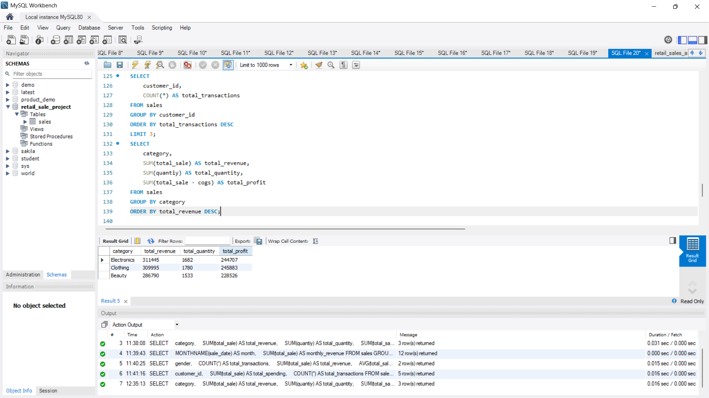
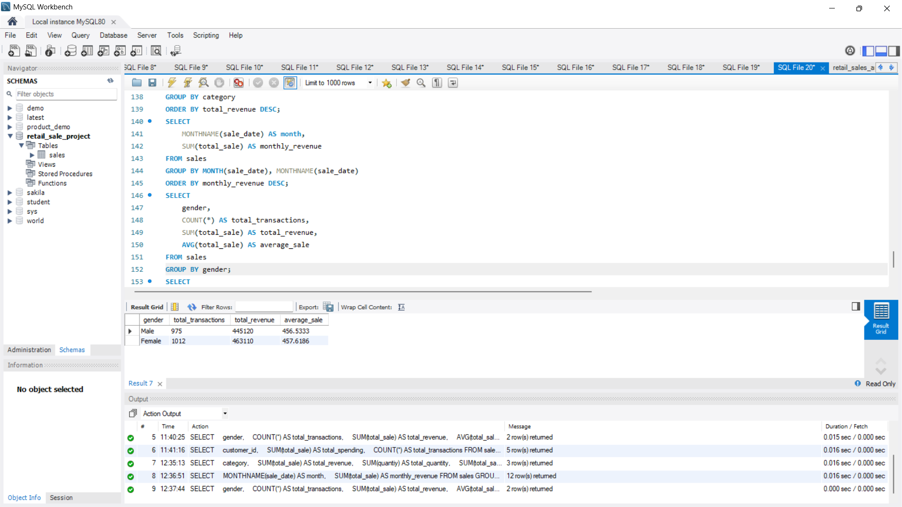

# Retail Sales Analysis using SQL

## Project Overview
This project focuses on analysing retail sales data using MySQL. The objective is to understand sales performance, customer purchasing behaviour, and product category performance through SQL queries.

## Tools Used
- MySQL
- MySQL Workbench
- SQL

## Dataset
The project uses a Retail Sales Dataset containing transaction details such as:
- Transaction ID
- Sale Date and Time
- Customer ID
- Gender
- Age
- Product Category
- Quantity
- Price Per Unit
- Cost of Goods Sold (COGS)
- Total Sale Amount

## Project Objectives
- Calculate total revenue and total transactions.
- Analyse revenue by product category.
- Understand customer purchasing behaviour.
- Identify top-spending customers.
- Analyse monthly sales performance.
- Calculate profit by category.
- Rank product categories based on revenue.

## SQL Concepts Used
- SELECT and DISTINCT
- WHERE and HAVING
- GROUP BY and ORDER BY
- Aggregate functions (SUM, AVG, COUNT, MAX)
- Subqueries
- Common Table Expressions (CTEs)
- Window functions (RANK)
- LIMIT

## Project Structure
```text
Retail-Sales-Analysis/
│
├── retail_sales_analysis_queries.sql
└── README.md
```
## Business Insights

Based on the SQL analysis, the following business insights were identified:

1. **Highest Revenue Category:** Electronics generated the highest revenue of 311,445.

2. **Highest Quantity Sold:** Clothing recorded the highest quantity sold, with 1,780 units.

3. **Highest Profit Category:** Clothing generated the highest profit of 245,883.

4. **Best Performing Month:** December recorded the highest monthly revenue of 141,025.

5. **Lowest Revenue Month Among Results:** July recorded the lowest monthly revenue of 58,120 among the months returned by the analysis.

6. **Sales by Gender:** Female customers generated higher revenue (463,110) than male customers (445,120). Average transaction values were almost equal.

7. **Top Customer:** Customer 3 was the highest-spending customer, with total spending of 38,440 across 76 transactions.
   ## Screenshots

### Category Analysis


### Monthly Revenue


### Sales by Gender


### Top Customers


## Conclusion

This project demonstrates how SQL can be used to analyse retail sales data, identify customer purchasing patterns, compare category performance, and generate meaningful business insights. It provided practical experience with SQL aggregation, filtering, subqueries, and window functions.
